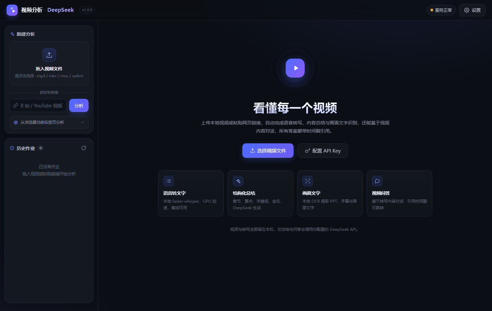
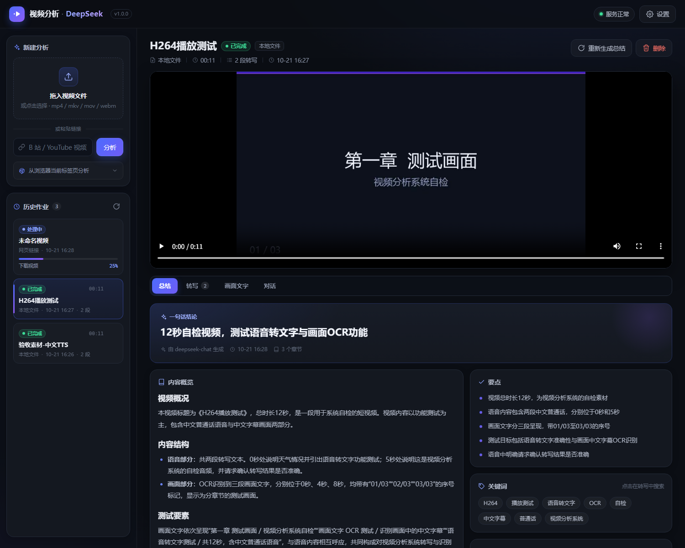
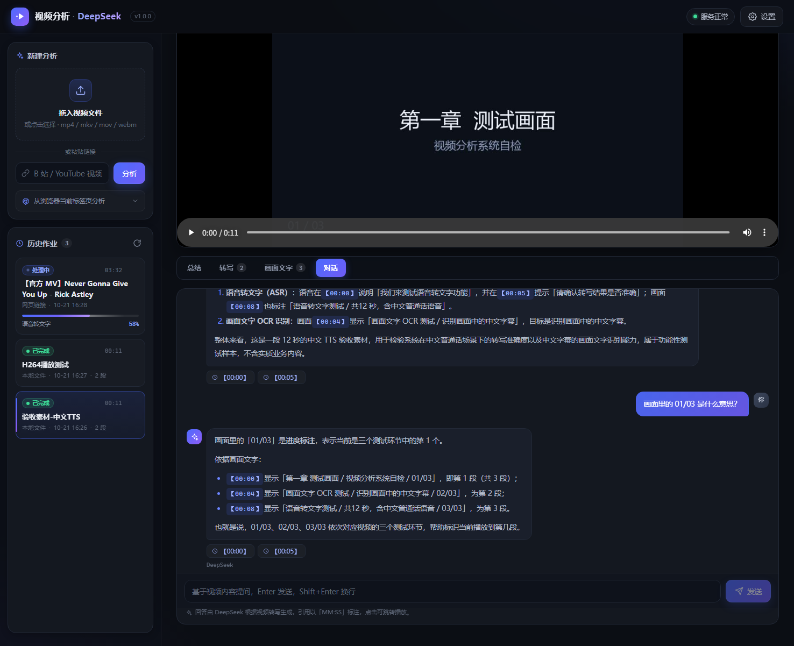

# 视频分析

> 把网页里正在播放的视频、视频链接或本地视频文件，变成**可搜索的转写文字 + 结构化总结 + 可对话的 AI 助手**。
> 音频转文字全程在本机 GPU 上完成，视频内容理解与问答由 **LLM-API** 驱动。
>
> 项目仓库：[renyu2002/Radio-Analysis](https://github.com/renyu2002/Radio-Analysis) · 本地运行工具（Web 界面 + Chrome MV3 扩展）



## 功能

| 能力 | 说明 |
|---|---|
| 🎙️ 音频转文字 | 本地 **faster-whisper large-v3**（RTX GPU 加速、离线、中文效果好），带时间戳，可导出 TXT / SRT |
| 🧠 内容总结 | **DeepSeek** 生成一句话结论、内容概览、章节（带时间戳）、要点、关键词、金句 |
| 🖼️ 画面文字 | 关键帧抽取 + 本地 **RapidOCR**（PP-OCRv6）识别 PPT / 字幕 / 画面文字，补足纯语音看不到的信息 |
| 💬 视频问答 | 基于转写 + 画面文字的检索问答，**DeepSeek** 流式回答，引用 `【MM:SS】` 可点击跳转播放 |
| 🎬 三种来源 | ① 本地视频文件（拖拽）② 网页链接（B站 / YouTube 等，yt-dlp 下载）③ **Chrome 扩展**一键抓取当前标签页正在播放的视频 |
| 🔒 隐私 | 视频与转写全部留在本机；只有「总结/问答」会把转写文本发给你配置的 DeepSeek API |

## 快速开始

环境：Windows 10/11 · Python 3.12 · NVIDIA 显卡（CPU 也能跑，只是慢）· Chrome（用扩展的话）

```powershell
# 1) 安装（首次 3-5 分钟：依赖 + CUDA 运行库 + Whisper 模型约 3GB）
PowerShell -ExecutionPolicy Bypass -File .\setup.ps1
#    网络慢可用清华镜像：.\setup.ps1 -Mirror

# 2) 启动（自动打开浏览器 http://127.0.0.1:8765）
.\run.ps1
```

首次运行后，在网页右上角 **⚙ 设置** 里填入 DeepSeek API Key（[platform.deepseek.com](https://platform.deepseek.com) 申请），保存后即可生成总结与问答。
也可以提前设置环境变量 `DEEPSEEK_API_KEY`（优先级高于网页设置）。

## 使用方式

### 1. 本地视频文件
把 `mp4 / mkv / mov / webm / avi` 拖进左侧「拖入视频文件」区域，或点击选择文件。上传完成后自动开始分析（进度实时显示）。

### 2. 网页链接
在左侧输入框粘贴 B 站 / YouTube 等视频页面链接，点「分析」。后端用 yt-dlp 下载（自动合并音视频轨）后分析。
> 需要登录/会员的站点可能需要浏览器 cookies；受 DRM 保护的视频无法下载。

### 3. 浏览器里正在播放的视频（Chrome 扩展）
1. 打开 `chrome://extensions` → 右上角打开「开发者模式」→「加载已解压的扩展程序」→ 选择项目的 `extension` 目录；
2. 先运行 `.\run.ps1` 启动本地服务；
3. 在任意视频网页（B站、YouTube、网课平台……）播放视频，点浏览器工具栏的扩展图标 →「分析这个视频」→「打开分析界面」。

扩展会读取当前页面地址与页面中的 `<video>` 元素；对 B站/YouTube 等站点直接用页面链接交给后端下载，对 blob 流媒体会给出中文提示。

## 界面说明



- **总结**：一句话结论、章节卡片（点击时间跳转）、要点、关键词（点击搜索转写）、金句、画面文字线索；支持「重新生成总结」。
- **转写**：带时间戳的分段文本，可搜索、点击定位播放、复制全文、导出 TXT/SRT。
- **画面文字**：关键帧时间线 + OCR 文本 + 缩略图预览。
- **对话**：基于视频内容提问（Enter 发送 / Shift+Enter 换行），流式回答，引用时间戳可点击跳转；问答记录保存在本地。
- 左上角历史作业列表可切换/删除作业；播放器支持拖动定位。



## 工作原理

```
视频来源 ──► 采集(yt-dlp/上传) ──► faster-whisper(GPU) ──► 带时间戳转写
                                   │
                                   └─► 关键帧抽取 ──► RapidOCR ──► 画面文字（时间线）
                                                                   │
转写 + 画面文字 + 元信息 ──► DeepSeek 总结（长视频分块 map-reduce） ──► 结构化 JSON
                                                                   │
提问 ──► 本地 BM25 检索（中文 bigram）取相关片段 ──► DeepSeek 流式回答 + 时间戳引用
```

- **为什么画面理解用 OCR 而不是视觉模型？** DeepSeek 官方 API 目前只支持文本，没有视觉/语音接口。因此本项目用「本地 Whisper + 本地 OCR」把视频转成文本，再交给 DeepSeek 理解——所有对 DeepSeek 的调用都是文本 API，完全符合「API 都用 DeepSeek」。设置里也预留了可选的 OpenAI 兼容视觉模型（默认关闭），需要时再开。
- **为什么 Whisper 用本地？** DeepSeek 没有语音转写 API；本地 faster-whisper 在 RTX 4080 上转写 12 秒素材约 2 秒，1 小时视频约 2-4 分钟，免费且隐私安全。

## 目录结构

```
视频分析/
├─ run.ps1 / setup.ps1        # 启动 / 安装脚本
├─ .gitignore / .gitattributes / requirements.txt
├─ vanalyze/
│  ├─ config.py models.py settings.py   # 共享配置与数据模型
│  ├─ core/                   # 采集、ASR、抽帧OCR、DeepSeek 客户端、总结、问答、流水线
│  ├─ server/                 # FastAPI 服务、作业管理、SSE 问答
│  ├─ store.py                # SQLite 持久化（作业/消息）
│  └─ __main__.py             # python -m vanalyze 启动入口
├─ web/                       # 前端单页应用（原生 HTML/CSS/JS，无构建）
├─ extension/                 # Chrome MV3 扩展
├─ tests/                     # pytest 单元/API/E2E/UI 冒烟测试
├─ docs/                      # 架构契约 / 验收报告 / 截图
└─ data/                      # 运行期数据（自动创建，已被 git 忽略）
   ├─ app.db                  # 作业与对话记录
   ├─ settings.json           # 设置（含 API Key，仅本机）
   ├─ uploads/                # 上传的视频
   └─ jobs/<id>/              # 每个作业的媒体、转写、帧、总结
```

## 常用命令

```powershell
$env:PYTHONUTF8 = 1

# 启动（等同于 run.ps1）
.\.venv\Scripts\python.exe -m vanalyze --port 8765

# 跑测试（单元 + API + 扩展静态检查；DeepSeek 用本地 stub，不消耗额度）
.\.venv\Scripts\python.exe -m pytest tests -q

# 真实流水线 E2E（会加载 Whisper/OCR，约 20s；单独运行，不在 pytest 默认收集内）
.\.venv\Scripts\python.exe tests\e2e.py

# 真实全链路冒烟（会在临时端口起服务、跑完自动清理）
.\.venv\Scripts\python.exe -m vanalyze.server._smoke

# 查看 GPU / 转写设备
.\.venv\Scripts\python.exe -c "from vanalyze.settings import load_settings; from vanalyze.core.asr import detect_device; print(detect_device(load_settings()))"
```

## 配置项

网页「设置」或环境变量（环境变量优先）：

| 环境变量 | 说明 | 默认 |
|---|---|---|
| `DEEPSEEK_API_KEY` | DeepSeek API Key | 空 |
| `DEEPSEEK_BASE_URL` | OpenAI 兼容 Base URL | `https://api.deepseek.com` |
| `DEEPSEEK_MODEL` | 总结/问答模型 | `deepseek-chat` |
| `VANALYZE_WHISPER_MODEL` | whisper 模型 | `large-v3` |
| `VANALYZE_WHISPER_DEVICE` | `auto`/`cuda`/`cpu` | `auto` |
| `VANALYZE_PORT` | 服务端口 | `8765` |

设置保存在 `data/settings.json`，只在本机使用；`data/` 已在 `.gitignore` 中忽略，不会被提交。

## 安全与隐私

- **仓库不含任何密钥**：DeepSeek API Key 只存在于你本机的 `data/settings.json`（或环境变量 `DEEPSEEK_API_KEY`）。克隆仓库后请自行申请并填入，不要将 `data/` 提交到公开仓库。
- **数据不出本机**：视频、音频、转写、画面帧、对话记录均保存在 `data/` 目录；删除该目录即彻底清空。
- **只发送必要文本**：只有「生成总结 / 视频问答」会把**转写文本（及画面文字）**发送给你配置的 DeepSeek API；视频文件本身不会上传。
- **测试不消耗额度**：`pytest` 使用本地 DeepSeek stub，只有 `tests/real_key_check.py` 会调用真实 API。
- 本工具会用到 yt-dlp 下载网页视频，请遵守目标平台的服务条款与版权规定；受 DRM 保护的视频无法下载与解析。

## 常见问题

- **端口被占用**：`.\.run.ps1 -Port 8766`；Chrome 扩展里可改后端地址（默认 8765），或把新端口加入扩展 `host_permissions` 后重新加载。
- **视频在网页播放器里黑屏/无法播放**：浏览器不支持该视频编码（如 HEVC/H.265、MPEG-4 Part 2）。这不影响转写、总结与问答，可下载原视频到本地播放。H.264/VP9/AV1 编码可正常在线播放。
- **首次分析很慢**：第一次会下载 Whisper 模型（large-v3 约 3GB），之后走本地缓存；GPU 上 1 小时视频转写约 2-4 分钟。
- **没有 NVIDIA 显卡**：可以跑，自动降级 CPU（`large-v3` 会较慢，可在设置里换 `small`/`medium`）。
- **视频下载失败**：受 DRM 保护、需要登录/会员、或地区限制的视频无法直接下载；可先下载到本地再拖入。
- **画面文字识别不准**：OCR 对分辨率低、艺术字、竖排文字效果有限；可调大设置中的关键帧数量上限。
- **数据/隐私**：视频、转写、对话、API Key 都只在本机 `data/` 目录；删掉 `data/` 即彻底清空。提问与转写内容会发送给 DeepSeek API 用于生成回答。

## 开发者

- 接口契约与数据模型：`docs/CONTRACT.md`
- 验收报告：`docs/VERIFICATION.md`
- 后端 Python 3.12 / FastAPI；前端无框架、无构建；扩展为 Manifest V3。
- 关键依赖：`faster-whisper`、`av==16.1.0`（pin 原因见契约）、`rapidocr`、`yt-dlp`、`imageio-ffmpeg`、CUDA 运行库（`nvidia-cudnn-cu12` 等，Windows 版）。

---

如果遇到问题，先看 `data/logs/` 与启动控制台输出；也可以直接删掉 `data/jobs/<id>` 重新分析。

## 免责声明

本项目仅用于个人学习与研究，按「现状」提供，不对使用后果作任何担保。请勿将其用于侵犯版权、绕过付费/DRM 或违反平台服务条款的用途；视频下载、内容分析及 DeepSeek API 调用产生的费用与合规责任由使用者自行承担。
