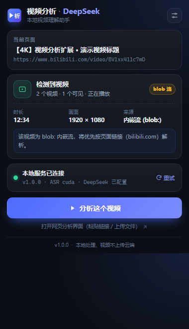

# 视频分析 · DeepSeek —— Chrome 扩展（MV3）

把浏览器里正在播放的视频一键交给本地「视频分析 · DeepSeek」服务，完成 **语音转写 / 内容总结 / 基于视频内容的问答**。
全程本地处理：扩展只把「页面地址 + 视频地址 + 标题 + 时长」发给 `http://127.0.0.1:8765`，视频文件不会上传到云端。



## 功能

- 自动读取当前标签页的标题 / URL；
- 注入检测函数扫描页面 `<video>`（含同源 iframe、Shadow DOM），优先取「可见 + 正在播放 + 面积最大」的视频，提取 `currentSrc / duration / poster`；
- 显示本地服务连接状态（`GET /api/health`），后端未启动时提示启动命令并自动重试；
- 「分析这个视频」一键提交 `POST /api/jobs`（`source_type: "tab"`，字段见 `docs/CONTRACT.md` §8.3），成功后显示「已提交：标题」与「打开分析界面」按钮；
- 未检测到视频时：已知视频站点可「按页面链接分析」；其他页面引导到网页分析界面（粘贴链接 / 上传文件）；
- `blob:` 内嵌流会提示后端将尝试用页面链接解析；
- 后端地址默认 `http://127.0.0.1:8765`，保存在 `chrome.storage.local`，popup 内可修改并保存、重试。

## 安装

1. 启动本地服务（项目根目录）：
   ```powershell
   .\run.ps1
   ```
   等待后端在 `http://127.0.0.1:8765` 可用。
2. Chrome 地址栏打开 `chrome://extensions`；
3. 打开右上角「**开发者模式**」；
4. 点击「**加载已解压的扩展程序**」，选择本目录：
   `<PROJECT_ROOT>\extension`；
5. （可选）点击工具栏拼图图标，把「视频分析 · DeepSeek」固定到工具栏。

> 修改扩展代码后，在 `chrome://extensions` 点击该扩展卡片上的「重新加载」即可生效。

## 使用

1. 在 B 站 / YouTube / 抖音 / Vimeo 等网页打开视频并开始播放；
2. 点击工具栏扩展图标：
   - 「当前页面」显示标签页标题与 URL；
   - 「检测结果」显示视频数量、时长、画面分辨率、来源；
   - 「本地服务状态」显示是否已连接（含后端版本、ASR 设备、DeepSeek Key 状态）；
3. 点击「**分析这个视频**」，popup 显示「已提交：标题」；
4. 点击「**打开分析界面**」在新标签页打开 `http://127.0.0.1:8765`，即可查看转写 / 总结 / 问答进度；
5. 若提示「未检测到视频」：
   - 已知视频站点：按钮变为「按页面链接分析」，后端会用 yt-dlp 尝试解析页面；
   - 其他页面：点「打开网页分析界面（粘贴链接 / 上传文件）」，或在网页端上传本地视频。

## 后端地址与端口

- 默认地址 `http://127.0.0.1:8765`，存储在 `chrome.storage.local`（键名 `backendUrl`）；
- 点击 popup 右上角设置按钮可编辑地址并「保存」，保存后自动重新连接；启动服务后点「重试」。
- `manifest.json` 只申请了 `http://127.0.0.1:8765/*` 的 host 权限。如果改成其他端口：
  后端需按契约 §8.20 允许 `chrome-extension://` 来源的 CORS 请求（默认 `allow_origins=["*"]` 已满足），
  否则浏览器会拦截跨源请求；此时可把新地址加入 `host_permissions` 并重新加载扩展。
- 本扩展不会申请 `<all_urls>`，不读取浏览历史，不向任何外部服务器发送数据。

## 权限说明

| 权限 | 用途 |
| --- | --- |
| `activeTab` | 点击扩展时临时获得当前标签页访问权，用于注入检测函数 |
| `scripting` | `chrome.scripting.executeScript` 注入视频检测函数 |
| `storage` | 保存本地服务地址（`chrome.storage.local`） |
| `tabs` | 读取当前活动标签页的标题与 URL |
| `host_permissions`（仅 `127.0.0.1:8765`） | 直接访问本地分析服务的 `/api/health`、`/api/jobs` |

## 工作原理

```text
点击扩展图标
  → chrome.tabs.query({active:true,currentWindow:true})          读取标题/URL
  → chrome.scripting.executeScript(detectVideosInPage)           注入检测
       · 主文档 + 同源 iframe 递归 + Shadow DOM 中查找 <video>
       · 优先级：可见且播放中 > 可见 > 后台播放；同档比可见面积
  → GET http://127.0.0.1:8765/api/health                          服务状态
  → POST http://127.0.0.1:8765/api/jobs                          创建 tab 来源作业
       {"source_type":"tab","page_url":"…","video_url":"…或 null",
        "title":"…","duration":123.4,"poster":null}
  → 成功：显示作业标题 + 「打开分析界面」（后端根地址）
```

后端对 `tab` 来源优先按 `page_url` 用 yt-dlp 解析；`video_url` 为 `blob:` 时自动退化到页面链接（契约 §6.3）。

## 文件结构

```
extension/
├─ manifest.json          # MV3 清单（权限最小化）
├─ popup.html             # popup 结构
├─ popup.css              # 深色主题样式（#0b0e14 / #4d6bfe）
├─ popup.js               # popup 状态机与交互
├─ shared.js              # 请求体构造 / 后端调用 / 视频检测注入函数
├─ icons/                 # icon16/32/48/128.png（由 make_icons.py 生成）
├─ make_icons.py          # Pillow 图标生成脚本
├─ README.md
└─ dev/                   # 自测脚本与素材，不参与扩展运行时
   ├─ mock_backend.py     # mock 后端（默认 8767，不占用 8765）
   ├─ browser_test.html   # Chrome 内执行 shared.js 逻辑测试
   ├─ frame_fixture.html  # 同源 iframe 视频 fixture
   ├─ preview.html        # popup 各状态预览 + DOM 上报（chrome API 打桩）
   ├─ verify_extension.py # 一键自测（静态 + mock + Chrome headless + 截图）
   └─ screenshots/        # 自测截图
```

## 开发与自测

```powershell
$env:PYTHONUTF8 = 1
# 生成 / 重新生成图标
.\.venv\Scripts\python.exe extension\make_icons.py --preview

# 一键自测：静态校验 + mock 后端 + Chrome headless 逻辑测试 + 截图
.\.venv\Scripts\python.exe extension\dev\verify_extension.py

# 可选：单独启动 mock 后端（8767）调试请求
.\.venv\Scripts\python.exe extension\dev\mock_backend.py
```

自测覆盖：
- `manifest.json` 合法、权限精确为 `activeTab/scripting/storage/tabs`、host 仅 8765、图标尺寸 16/32/48/128；
- mock 后端上验证 `GET /api/health`、CORS 预检、`POST /api/jobs` 请求体字段（`source_type/page_url/video_url/title/duration/poster`）与类型；
- Chrome headless 内执行 `shared.js`：请求体构造、地址规范化、格式化、`<video>` 检测（可见/播放优先、同源 iframe 递归、blob 识别）、真实 `fetch` 到 mock、后端未启动时的优雅失败；
- 用 chrome API / fetch 打桩渲染 popup 四种状态（检测成功 / 后端未启动 / 未检测到视频 / 提交成功），断言关键中文文案与按钮状态；
- `--screenshot` 截图检查样式（`dev/screenshots/`）。

## 已知限制

- **跨域 iframe** 内的视频无法读取（浏览器同源策略），popup 会提示；可改用「页面链接」或直接打开该 iframe 页面。
- **DRM 视频**（Netflix 等）无法下载，后端会返回中文错误提示。
- **`chrome://` 页面、Chrome 应用商店、PDF 阅读器** 等受保护页面禁止脚本注入，popup 会提示不支持。
- **`file://` 本地页面**需要在 `chrome://extensions` 中开启「允许访问文件网址」，否则请用网页端上传。
- 修改非 8765 端口时依赖后端 CORS（见上）。
- 真实浏览器交互（点击真实视频页、真实后端下载）无法在无人值守环境完整自动化；本仓库以静态校验 + mock 后端 + Chrome headless 打桩覆盖请求体与 UI 状态机。最终真实整链路由 `run.ps1` 启动后人工确认。
- 扩展只负责「提交作业」，转写/总结速度取决于本机 GPU 与模型加载。

## 自测结果

最近一次 `verify_extension.py` 结果：**173/173 项通过**（详见 `dev/test-report.json`，含静态校验、mock 契约、Chrome headless 逻辑测试 39 项、popup 四状态 DOM 断言与截图校验）。
截图：
- `dev/screenshots/popup-raw.png`：直接以 `file://` 打开 popup.html 的降级预览；
- `dev/screenshots/preview-detected.png`：已连接 + 检测到视频；
- `dev/screenshots/preview-offline.png`：后端未启动提示；
- `dev/screenshots/preview-success.png`：提交成功 + 打开分析界面。

> 自测不依赖真实后端与真实视频页面：mock 后端监听 8767，Chrome headless 负责执行页面内 JS；8765 留给真实服务。
> `chrome://extensions` 手工加载扩展、真实视频页面抓取与真实下载需人工确认（无头 Chrome 不支持 `--load-extension` 交互验证）。
